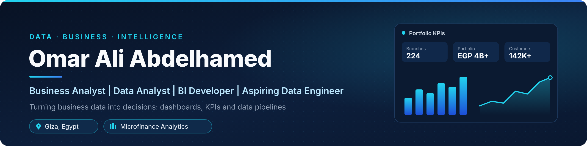
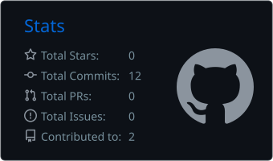
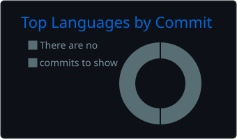
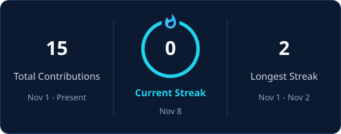

  

  
  
  
  

👋 About Me
I'm Omar Ali Abdelhamed, a Business Data Analytics Specialist at Reefy Microfinance Enterprise Services with a Bachelor's degree in Artificial Intelligence.
I sit where business and data meet. I turn operational data into dashboards, KPIs and recommendations that leadership can act on, and I build the pipelines and data warehouses that keep that data reliable.
📊 Business & data analysis: I translate business questions into metrics, analyses and clear recommendations.
📈 Business intelligence: I design Power BI and Apache Superset dashboards and automated reports for management.
🏗️ Data engineering: I build ETL pipelines, data warehouses and data marts with Python, Airflow, PostgreSQL and Docker.
⚙️ Process automation: I build internal business systems with Power Apps, Power Automate and SharePoint.
🔭 Currently growing toward: data engineering, through the DEPI Data Engineer track.
💼 Experience
Business Data Analytics Specialist · Reefy Microfinance Enterprise Services
February 2026 – Present · Egypt
Scale I work with	
🏢 224 branches	💰 EGP 4B+ portfolio
👥 5,000+ employees	🤝 142,000+ customers
Analyze business and operational performance across 224 branches and a microfinance portfolio of more than EGP 4 billion.
Develop Power BI dashboards and automated reports that track KPIs, employee performance and branch productivity.
Monitor product KPIs, including loan amount, loan count, PAR 30/60/90/120 and provisions, across branches and governorates.
Analyze product performance, profitability, demand and risk to support product development for SME Finance and Islamic Finance.
Turn analysis into business insights and data-driven recommendations for management.
Build HR workflow automation with Power Apps and SharePoint for hiring, resignations and Branch HR ↔ Head Office HR communication.
Develop ETL pipelines and data warehouse solutions with PostgreSQL, Python, Apache Airflow and Docker.
Build management dashboards in Apache Superset and a TeleSales tracking system for Facebook campaign leads.
🚀 Featured Projects
<table>
<tr>
<td width="50%" valign="top">
<h3>🏗️ HR Data Warehouse &amp; Analytics</h3>

An end-to-end HR data platform covering data collection, ETL, data warehousing, data marts and BI dashboards.

<ul><li>HR data captured through Power Apps and stored in SharePoint</li><li>Automated ETL pipelines with Python and Apache Airflow, running in Docker</li><li>Central PostgreSQL data warehouse with fact and dimension tables</li><li>Analytical data mart views powering HR KPI dashboards in Apache Superset</li></ul>

      

    

🔒 <b>Internal project at Reefy.</b> The source code is private and not publicly available.

</td>
<td width="50%" valign="top">
<h3>📊 Microfinance Product Analytics</h3>

Product and portfolio analytics across 224 branches and every governorate, supporting a portfolio of more than EGP 4 billion.

<ul><li>Tracks loan amount, loan count, PAR 30/60/90/120 and provisions</li><li>Evaluates product initiatives: performance, contribution and rates</li><li>Analyzes portfolio growth and branch performance</li><li>Supports SME Finance and Islamic Finance product decisions</li></ul>

 

  

🔒 <b>Internal project at Reefy.</b> The source code is private and not publicly available.

</td>
</tr>
<tr>
<td width="50%" valign="top">
<h3>📞 TeleSales Tracking System</h3>

A business process automation system that follows customer leads from Facebook campaigns to a final loan decision.

<ul><li>Lead capture and tracking built with Power Apps and SharePoint</li><li>Tracks each lead through approval, rejection and pending stages</li><li>Sales funnel analysis and real-time dashboards for management</li></ul>

  

🔒 <b>Internal project at Reefy.</b> The source code is private and not publicly available.

</td>
<td width="50%" valign="top">
<h3>🌦️ Tourism Weather Intelligence ETL</h3>

A data engineering project that builds an automated ETL pipeline for weather data relevant to tourism.

<ul><li>Extracts weather data from the Open-Meteo API with Python</li><li>Transforms the data and loads it into PostgreSQL</li><li>Orchestrated with Apache Airflow and containerized with Docker</li></ul>

   

📂 The repository link will be added here once it is published.

</td>
</tr>
</table>
🧰 Tech Stack
<table>
<tr><td><b>Programming &amp; Data Analysis</b></td><td>
<table><tr><td align="center" width="96"> <b>Python</b></td><td align="center" width="96"> <b>Pandas</b></td><td align="center" width="96"> <b>NumPy</b></td><td align="center" width="96"> <b>Matplotlib</b></td></tr><tr><td colspan="4"></td></tr></table>
</td></tr><tr><td><b>Business Intelligence &amp; Visualization</b></td><td>
<table><tr><td align="center" width="96"> <b>Power BI</b></td><td align="center" width="96"> <b>Power Query</b></td><td align="center" width="96"> <b>Advanced Excel</b></td><td align="center" width="96"> <b>Apache Superset</b></td></tr><tr><td colspan="4"></td></tr></table>
</td></tr><tr><td><b>Data Engineering</b></td><td>
<table><tr><td align="center" width="96"> <b>Apache Airflow</b></td><td align="center" width="96"> <b>Docker</b></td><td align="center" width="96"> <b>SQLAlchemy</b></td></tr><tr><td colspan="3">  </td></tr></table>
</td></tr><tr><td><b>Databases</b></td><td>
<table><tr><td align="center" width="96"> <b>PostgreSQL</b></td><td align="center" width="96"> <b>SQL Server</b></td><td align="center" width="96"> <b>MySQL</b></td><td align="center" width="96"> <b>MongoDB</b></td></tr></table>
</td></tr><tr><td><b>Microsoft Power Platform</b></td><td>
<table><tr><td align="center" width="96"> <b>Power Apps</b></td><td align="center" width="96"> <b>Power Automate</b></td><td align="center" width="96"> <b>SharePoint</b></td></tr></table>
</td></tr><tr><td><b>Development Tools</b></td><td>
<table><tr><td align="center" width="96"> <b>Git</b></td><td align="center" width="96"> <b>GitHub</b></td><td align="center" width="96"> <b>VS Code</b></td><td align="center" width="96"> <b>Jupyter Notebook</b></td></tr></table>
</td></tr>
</table>
📈 GitHub Stats

  
  

  

🏆 Achievements & Certifications
<table>
<tr>
<td width="50%" valign="top">
🏆 Key Achievements
🥇 1st Place Nationwide, Microsoft Power BI Track, Digital Egypt Pioneers Initiative (DEPI)
🥇 1st Place in the Delta Region with a startup project
🥈 2nd Place, Tanta Hackathon
🚀 Developed two internal business systems supporting HR and TeleSales operations
🏗️ Built an end-to-end HR data platform covering data collection, ETL, data warehousing, data marts and BI dashboards
</td>
<td width="50%" valign="top">
📜 Certifications
DEPI – Data Engineer Track (2026)
DataCamp – Associate Data Engineer in SQL (2025)
DataCamp – Associate Data Analyst in SQL (2025)
DEPI – Microsoft Power BI Specialization (2024)
Orange Digital Center – Big Data Training (2024)
NTI – Freelancing for Data Analysis (2024)
NTI – Huawei AI Training (2024)
Zewail City – Introduction to Artificial Intelligence and its Applications (2023)
</td>
</tr>
</table>
🎓 Education
Bachelor of Artificial Intelligence · Faculty of Artificial Intelligence, Kafrelsheikh University · GPA 3.3
🤝 Let's Connect
I'm always happy to talk about data analytics, business intelligence and data engineering.

  
  

  

